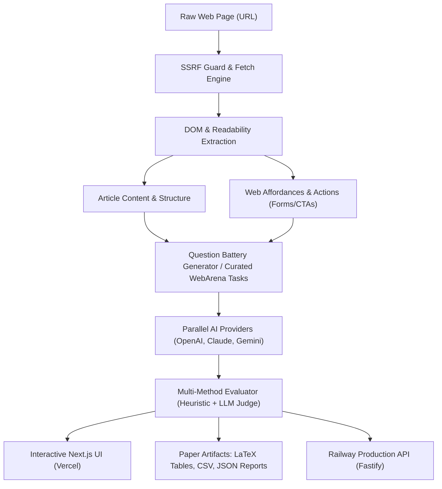
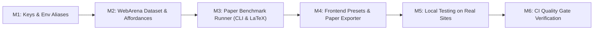

# Implementation Plan: Paper-Level AI Website Evaluator & Benchmark

## 1. Executive Summary & Scientific Objective

The goal of this project is to refactor and scale the **AI Web Reading Benchmark** into a **scientifically rigorous, publication-grade evaluation framework and tool** ready for academic dissemination (e.g., conferences such as NeurIPS, ICLR, ACL, or WWW workshops on Web Agents and Information Retrieval).

### Core Research Questions
1. **Comprehension vs. Noise**: How effectively do modern Frontier LLMs (OpenAI GPT-4o, Anthropic Claude 3.5/3.7, Google Gemini) parse noisy, real-world web pages vs. clean article extractions?
2. **Actionability & Affordance Recognition**: Can an AI not only read text but deduce what actions an end-user can take on that website (search, navigate, authenticate, buy, filter)?
3. **Abstention & Hallucination Resistance**: When requested facts or capabilities are absent from a page, does the model accurately abstain (`NOT_IN_PAGE`), or does it hallucinate believable facts?
4. **Cross-Model Agreement & Latency Tradeoffs**: What are the agreement rates (Cohen's $\kappa$), latency distributions, and cost-efficiency trade-offs across model tiers?

---

## 2. API Key Architecture & Provider Calibration

### Current State
- `.env` contains:
  - `OPEN-AI-KEY` (Active & verified with `gpt-4o-mini` / `gpt-4o`)
  - `CLAUDE-KEY` (`sk-ant-usr-...` unscoped user key, requiring workspace header or workspace ID)
- Current backend strictly checked `OPENAI_API_KEY` and `ANTHROPIC_API_KEY`.
- Anthropic default model was set to non-existent `claude-opus-5`.

### Improvements
1. **Transparent Credential Aliasing**:
   Update `backend/src/config/env.ts` to accept:
   - OpenAI: `OPENAI_API_KEY` || `OPEN-AI-KEY` || `OPEN_AI_KEY`
   - Anthropic: `ANTHROPIC_API_KEY` || `CLAUDE-KEY` || `CLAUDE_KEY` || `CLAUDE_API_KEY`
   - Workspace ID: `ANTHROPIC_WORKSPACE_ID` || `CLAUDE_WORKSPACE_ID`
2. **Calibrated Model Defaults**:
   Update `backend/src/config/models.ts`:
   - `openai`: `gpt-4o-mini` (fast benchmark default) or `gpt-4o` (configurable via `OPENAI_MODEL`)
   - `claude`: `claude-3-5-haiku-20241022` or `claude-3-5-sonnet-20241022` / `claude-3-7-sonnet-20250219` (configurable via `ANTHROPIC_MODEL`)
   - `gemini`: `gemini-2.5-pro` (graceful fallback to `unavailable` when no key is set)
3. **Workspace Header Support**:
   In `backend/src/providers/claude.ts`, pass `defaultHeaders: { 'anthropic-workspace-id': workspaceId }` when an unscoped key is used.

---

## 3. WebArena-Aligned Real-World Dataset

To achieve paper-level empirical rigor, we will build a curated dataset (`benchmarks/webarena_dataset.json`) representing real-world counterparts to WebArena's canonical domains:

| Web Domain | WebArena Archetype | Example Real-World Test Sites | Evaluation Focus |
|---|---|---|---|
| **E-Commerce** | OneStopShop | Amazon Product, Shopify Storefront, BestBuy item | Price, specs, variants, "Add to Cart" affordance, delivery window |
| **Community & Social** | Postmill / Reddit | Hacker News thread, Reddit post, StackOverflow | Top comment, author, upvotes, reply affordances, thread structure |
| **Collaborative Tech** | GitLab | GitHub Repository, Fastify Documentation, MDN Web Docs | Primary heading, installation command, license, repo release version |
| **Knowledge Base** | Wikipedia | Wikipedia featured article (History/Science), Britannica | Infobox attributes, cloze factual recall, section cross-referencing |
| **Media & Journalism** | News CMS | BBC News article, TechCrunch article | Headline, author byline, publication timestamp, main thesis, absent fact abstention |

---

## 4. Evaluation Taxonomy & Scientific Metrics

The evaluation engine will score 4 distinct cognitive dimensions + 1 safety dimension:

1. **`EXTRACTION` (Factual Precision)**:
   - Measures exact retrieval of high-entropy factual tokens (entities, numbers, dates, titles).
2. **`COMPREHENSION` (Semantic Grounding)**:
   - Cloze deletion completion and main claim comprehension grounded solely in the retrieved DOM text.
3. **`RELATION` (Structural Reasoning)**:
   - Associating multi-hop information (e.g., which section discusses a concept, tabular column-row relations).
4. **`USABILITY_AFFORDANCE` (Actionability for User & Agents)**:
   - Detecting whether a user can interact with the page: primary CTA button text, search capability presence, navigation paths.
5. **`ABSTENTION` (Hallucination Rate)**:
   - Negative questions asking for facts known *not* to be on the page. Correct behavior is strict return of `NOT_IN_PAGE`.

### Metrics Generated for Publications:
- **Accuracy ($Acc$)**: $\frac{N_{\text{correct}} + 0.5 \times N_{\text{partial}}}{N_{\text{evaluable}}}$
- **Abstention Accuracy ($Acc_{\text{abstain}}$)**: Accuracy on negative questions.
- **Hallucination Rate ($HR$)**: Percentage of ungrounded responses when information is absent.
- **Inter-Model Agreement (Cohen's $\kappa$ / Fleiss' $\kappa$)**: Pairwise verdict consensus between OpenAI, Claude, and Gemini.
- **Latency & Throughput**: Time-to-First-Token (TTFT), total call duration (ms), and character-per-second processing speed.

---

## 5. Architecture & Deployment Readiness

### Backend (Railway Ready)
- **Fastify Engine**: Fast, typed, low-overhead HTTP daemon.
- **Production Config**: Binds to `0.0.0.0:${PORT}` with healthchecks at `/api/health`.
- **CORS Hardening**: Accepts configured `FRONTEND_URL` plus localhost and Vercel domains (`https://*.vercel.app`).
- **Security & SSRF Guard**:
  - DNS resolution check before fetching.
  - Strict blocking of loopback, private RFC-1918, link-local, and cloud metadata (169.254.169.254).
  - Max response size cap (2MB) and timeout guards (10s).
  - Complete zero-leakage guarantee: Secrets are scrubbed from logs, errors, and JSON responses.

### Frontend (Vercel Ready)
- **Next.js Single-Page Application (App Router)**: Fast, modern UI built with Tailwind CSS.
- **WebArena Presets Dropdown**: Reviewers or users can test real websites with 1-click.
- **Paper Export Toolbar**:
  - **Export JSON**: Raw structured benchmark data.
  - **Export CSV**: Per-question granular results for Python/Pandas analysis.
  - **Export LaTeX Table**: Pre-formatted `\begin{table}` code ready for Overleaf / LaTeX papers.
- **Deploy Config**: `vercel.json` already configured for `npm run build -w frontend`.

---

## 6. Implementation Milestones

### Phase 1: Environment & Provider Calibration
- Add key aliasing (`OPEN-AI-KEY` -> `OPENAI_API_KEY`, `CLAUDE-KEY` -> `ANTHROPIC_API_KEY`).
- Update default models in `backend/src/config/models.ts` to active models (`gpt-4o-mini`, `claude-3-5-haiku-20241022`).
- Support `ANTHROPIC_WORKSPACE_ID` in `backend/src/providers/claude.ts`.
- Ensure tests in `backend/tests/` still use mock mode and pass 100%.

### Phase 2: WebArena Dataset & Affordance Extraction
- Create `benchmarks/webarena_dataset.json` with 10+ real URLs and annotated questions covering E-commerce, Tech, Wiki, Forum, and News.
- Extend `backend/src/scraper/extract.ts` to capture page affordances (CTAs, search inputs, interactive forms).
- Extend `backend/src/benchmark/questions.ts` to include usability/affordance and abstention testing.

### Phase 3: Paper Evaluation Engine & CLI Tools
- Implement `scripts/run-paper-benchmark.mjs` to run automated evaluations against the WebArena dataset.
- Implement export formats:
  - `reports/benchmark-summary.json`
  - `reports/benchmark-summary.csv`
  - `reports/paper-tables.tex` (LaTeX table with category breakdowns and model comparison).
- Implement `npm run test:live` in backend for on-demand live testing.

### Phase 4: Frontend Usability & Paper Features
- Add WebArena preset selector to `UrlForm.tsx`.
- Add Export Buttons (JSON, CSV, LaTeX) to `ResultsPanel.tsx`.
- Update `.prettierignore` to include `frontend/next-env.d.ts`.

### Phase 5: Local Testing & Real-Site Verification
- Start local backend on port 3001.
- Start local frontend on port 3000.
- Execute real evaluations over real websites using OpenAI and Claude.
- Verify Railway & Vercel build compatibility.

### Phase 6: Quality Gates & Verification
- Run `npm run typecheck` (strict TypeScript, 0 errors).
- Run `npm run lint` (ESLint, 0 warnings/errors).
- Run `npm run format:check` (Prettier).
- Run `npm run dead-code` (Knip).
- Run `npm run test:unit`, `test:integration`, `test:regression`, `test:spec`, `test:security`, `test:smoke`.
- Run `npm run build` (backend + frontend).
