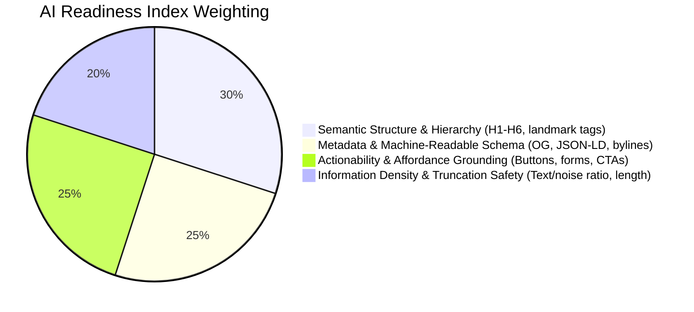
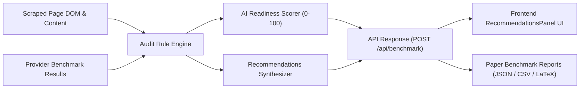

# AI Web Readability & Recommendations Specification (v1.0)

## 1. Vision & Problem Statement

Current web optimization (traditional SEO) is designed for search engine crawlers (Googlebot, Bingbot) indexing keywords and backlinks. However, the emerging paradigm of **Generative Engine Optimization (GEO)** and **AI Web Agents** requires websites to be readable, extractable, and actionable by Frontier Large Language Models:
- **ChatGPT / OpenAI Search**
- **Claude / Anthropic Computer-Use & Web Agents**
- **Gemini / Google AI Overviews & Agents**

When websites present poorly structured HTML, client-side rendered walls, missing semantic tags, stripped buttons, or ungrounded entity names, LLMs suffer from:
1. **Extraction Failure**: Inability to identify authors, prices, specs, and dates.
2. **Affordance Blindness**: Inability to understand how a user or agent can interact with the page (e.g. "Add to basket", "Sign up").
3. **Hallucination or Unwanted Abstention**: Returning `NOT_IN_PAGE` or guessing hallucinated facts.
4. **Token Inefficiency & Truncation**: Excessive boilerplate consuming the context window.

This engine evaluates the site and outputs an **AI Readiness Score (0-100)** and a categorized list of **Practical Recommendations for Website Builders**.

---

## 2. Evaluation Dimensions (The AI Readiness Index)

The site is audited across 4 core architectural dimensions:

1. **Semantic Structure & Document Flow (30%)**:
   - Valid single `<h1>` matching page title.
   - Proper hierarchical section nesting (`<h2>`, `<h3>`) with thematic coherence.
   - Content landmark tags (`<main>`, `<article>`, `<section>`).

2. **Metadata & Entity Grounding (25%)**:
   - Essential metadata tags: `og:title`, `og:description`, `author`, `article:published_time`.
   - Structured JSON-LD / Microdata for rich entity extraction.
   - Explicit document language (`<html lang="...">`).

3. **Actionability & Agent Usability (25%)**:
   - Semantic interactive elements (`<button>`, `<a href>`, `<form>`) rather than unsemantic `div`/`span` click handlers.
   - Explicit accessible labeling (`aria-label`, text content) on interactive widgets.
   - Clear primary Call-To-Action (CTA) identification.

4. **Information Density & Truncation Safety (20%)**:
   - Healthy word count (not thin content, not excessive single-page bloat over 12,000 chars).
   - Low boilerplate/ad ratio so Readability and LLM context windows focus on key facts.
   - Clear numerical and factual statements that resist cloze ambiguity.

---

## 3. Recommendation Taxonomy & Model Specifics

Each recommendation generated has:
- `id`: Unique identifier (e.g., `rec-structure-h1-missing`).
- `category`: `STRUCTURE` | `METADATA` | `AFFORDANCE` | `CONTENT_DENSITY`.
- `severity`: `CRITICAL` (causes AI retrieval breakdown) | `RECOMMENDED` (noticeable score gain) | `OPTIMIZATION` (best practice).
- `targetModels`: `['openai', 'claude', 'gemini']`.
- `title`: Short actionable summary.
- `explanation`: Why Frontier LLMs struggle with this on this page.
- `action`: Concrete code snippet or developer instruction to fix it.

### Model-Specific Guidance Provided to Builders:
* **For ChatGPT (OpenAI)**:
  - Markdown-friendly table layouts.
  - Distinct numeric values in plain text rather than embedded in image banners.
  - Clean `robots.txt` directives allowing `GPTBot` and `OAI-SearchBot`.
* **For Claude (Anthropic)**:
  - Deep hierarchical headings for long-context navigation.
  - Clear section scoping to avoid cross-section term ambiguity in prompt caching.
  - Explicit button and form labels for tool-use and computer-use agents.
* **For Gemini (Google)**:
  - Schema.org JSON-LD formatting (Product, Article, FAQPage, Organization).
  - OpenGraph / Dublin Core metadata alignment with Google Knowledge Graph.
  - Accurate `publishedTime` and author credentials for E-E-A-T grounding.

---

## 4. Architecture & Data Flow

